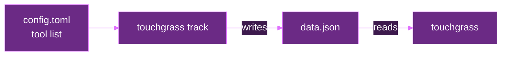
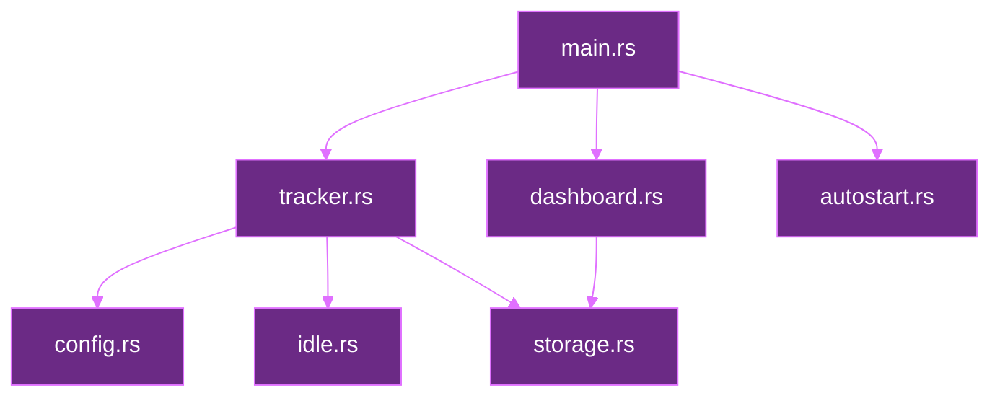
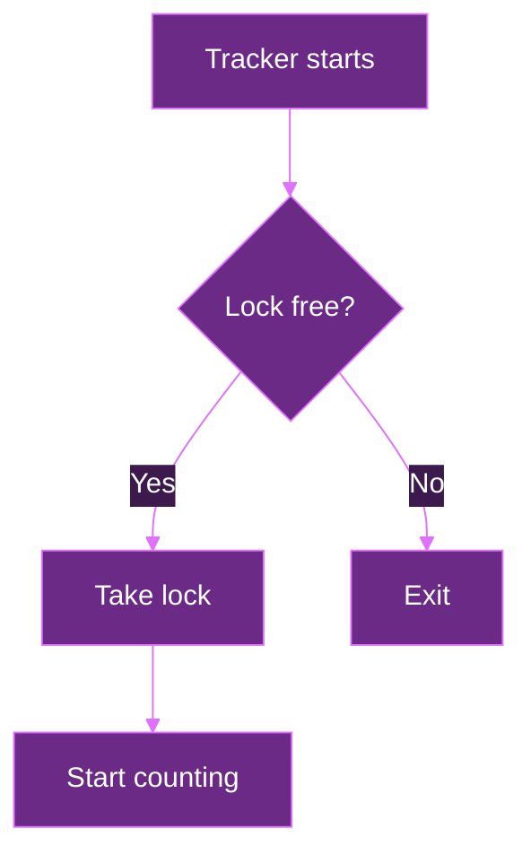
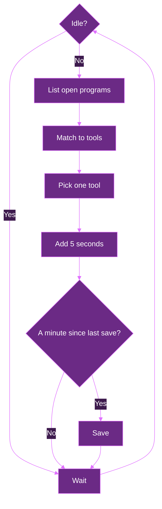
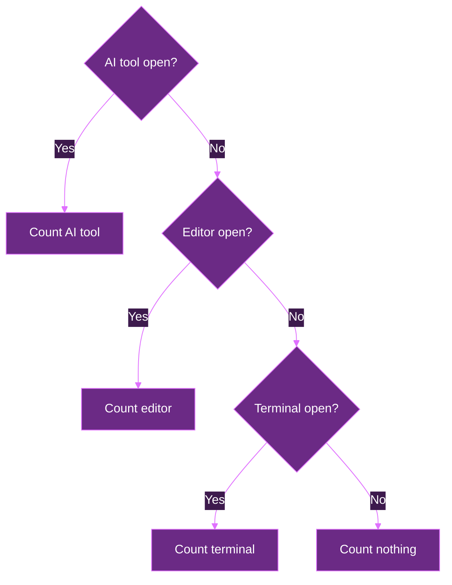

# Architecture

Tracks how long you spend in your dev tools. One command shows the totals, like fastfetch.

- Runs on macOS and Linux
- Each computer keeps its own time
- Only counts time when you're active, not just when a tool is open

## Goals

- `touchgrass` shows your time
- `touchgrass track` counts time in the background
- Time per tool: Claude Code, Codex, editors, terminal
- Totals for today, this week, and all time

## Flow

The tracker writes. The dashboard reads.



## Modules

One job per file.

- `main.rs` reads the command
- `config.rs` loads the tool list
- `tracker.rs` checks open programs and counts time
- `idle.rs` checks if you're at the computer
- `storage.rs` loads and saves time
- `dashboard.rs` adds up time and prints it
- `autostart.rs` adds and removes the login file



## Layout

```
touchgrass/
  Cargo.toml
  README.md
  ARCHITECTURE.md
  COMMANDS.md
  src/
    main.rs
    config.rs
    tracker.rs
    idle.rs
    storage.rs
    dashboard.rs
    autostart.rs
```

## Lockfile

Only one tracker runs at a time.

- The tracker holds a lock on `touchgrass.lock` in the data folder
- If another tracker holds it, the new one exits
- The OS drops the lock when the tracker stops, even on a crash, so there's never a stale file
- Uses the file lock built into Rust (`File::try_lock`), no extra crate



## Loop

Runs every 5 seconds.



## Idle

An open tool isn't a used tool. VS Code left open overnight shouldn't count.

- Idle means no keyboard or mouse input for 2 minutes
- Idle checks count nothing
- The limit is set in the config (`idle_after`, in seconds)
- Mac: reads the system idle time
- Linux: reads the idle time from X11 or the desktop session. If it can't, it counts as active and prints a warning once.

## Priority

- One tool gets time per check
- AI tools beat editors, editors beat terminal
- Same kind? First in the list wins
- No match, no time



## Config

Maps each tool to its program names. Edit it anytime, no rebuild needed.

- Mac: `~/Library/Application Support/touchgrass/config.toml`
- Linux: `~/.config/touchgrass/config.toml`
- Each tool has a name, a kind (ai, editor, terminal), and program names
- Created with defaults on first run
- Read again each minute, so changes apply without a restart

```
Claude Code   kind: ai        names: claude
Codex         kind: ai        names: codex
VS Code       kind: editor    names: code, Code Helper
Neovim        kind: editor    names: nvim
Terminal      kind: terminal  names: kitty, ghostty, iTerm2
