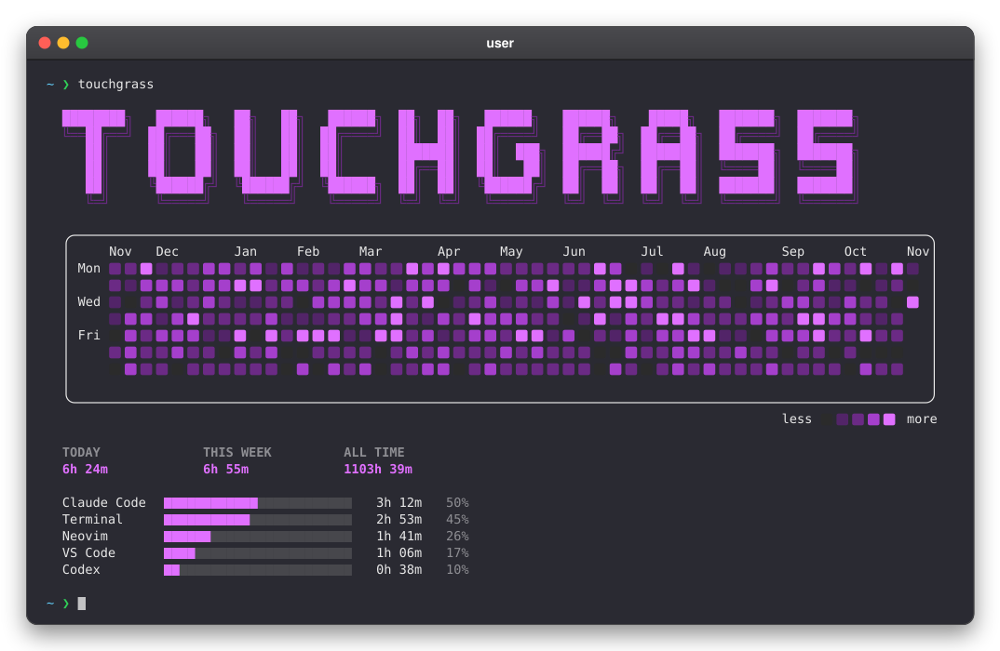

<div align="center">

### touchgrass

[](https://github.com/ado11231/touchgrass/actions/workflows/check.yml)
[](https://www.rust-lang.org)
[](#installation)
[](LICENSE)

track how long you spend in your dev tools



</div>

### Installation

Requires Rust 1.95 or newer on macOS or Linux.

```sh
git clone https://github.com/ado11231/touchgrass.git
cd touchgrass
cargo install --path . --locked
touchgrass install   # start tracking now and at every login
touchgrass           # show your time
```

On Linux, autostart needs a systemd user session. Idle checks use `xprintidle`
on X11 or `gdbus` on GNOME Wayland.

- [Commands and output](docs/COMMANDS.md)
- [Design, settings, and saved files](docs/ARCHITECTURE.md)
- [Contributing](docs/CONTRIBUTING.md)

[MIT license](LICENSE).
