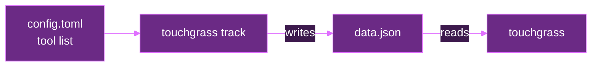
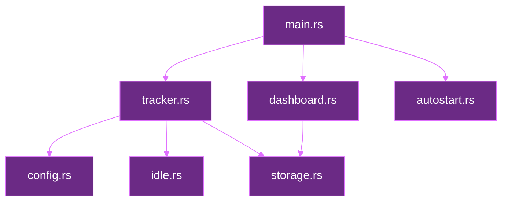
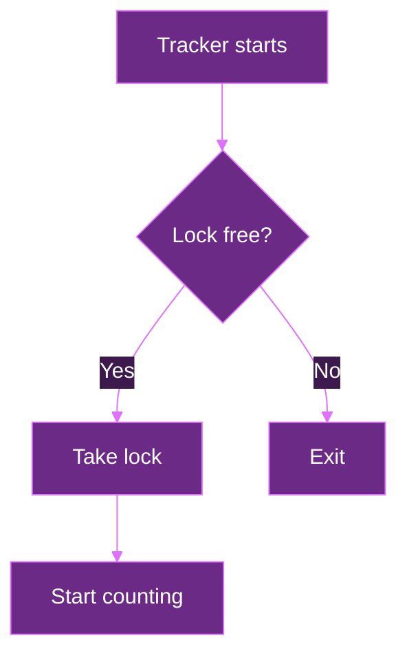
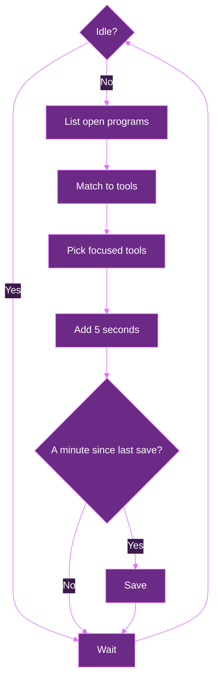
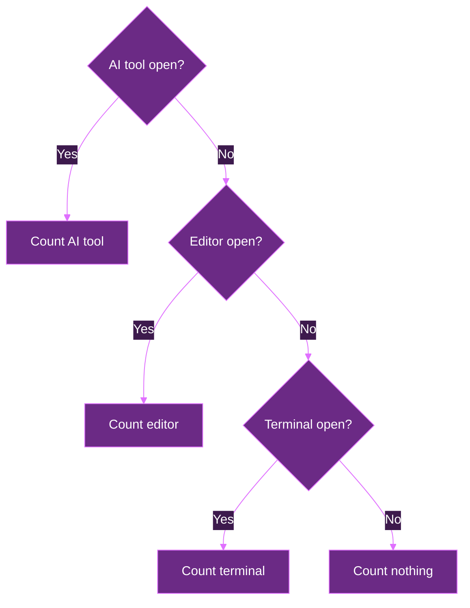
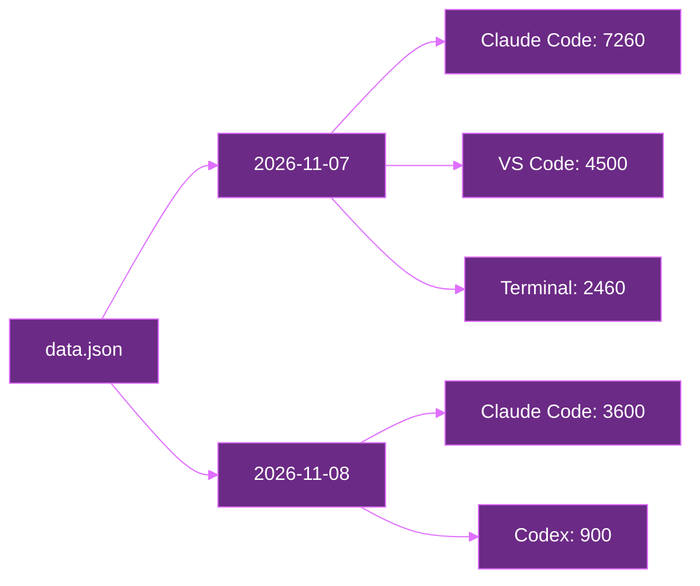
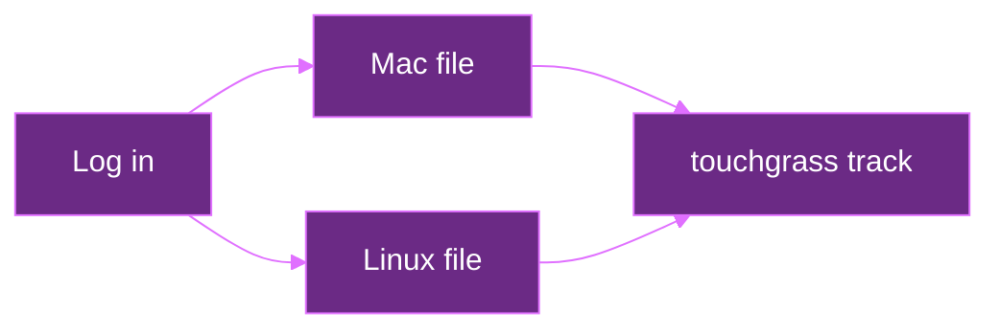

# Architecture

Tracks how long you spend in your dev tools. One command shows the totals, like fastfetch.

- Runs on macOS and Linux
- Each computer keeps its own time
- Only counts time when you're active, not just when a tool is open

## Goals

- `touchgrass` shows your time
- `touchgrass track` counts time in the background
- Time per tool: Claude Code, Codex, editors, terminal
- Totals for today, this week, and all time

## Flow

The tracker writes. The dashboard reads.



## Modules

One job per file. `main.rs` connects the modules. The arrows below show data flow, not module imports.

- `main.rs` reads the command and passes values between modules
- `config.rs` loads the tool list
- `tracker.rs` checks open programs and counts time
- `focus.rs` finds the app that owns the focused window
- `idle.rs` checks if you're at the computer
- `storage.rs` loads and saves time
- `dashboard.rs` adds up time and prints it
- `autostart.rs` adds and removes the login file



## Layout

```
touchgrass/
  Cargo.toml
  README.md
  LICENSE
  docs/
    ARCHITECTURE.md
    COMMANDS.md
    CONTRIBUTING.md
  src/
    main.rs
    config.rs
    tracker.rs
    idle.rs
    storage.rs
    dashboard.rs
    autostart.rs
```

## Lockfile

Only one tracker runs at a time.

- The tracker holds a lock on `touchgrass.lock` in the data folder
- If another tracker holds it, the new one exits
- The OS drops the lock when the tracker stops, even on a crash, so there's never a stale file
- Uses the file lock built into Rust (`File::try_lock`), no extra crate



## Loop

Runs every 5 seconds.



## Idle

An open tool isn't a used tool. VS Code left open overnight shouldn't count.

- Idle means no keyboard or mouse input for 2 minutes
- Idle checks count nothing
- The limit is set in the config (`idle_after`, in seconds)
- Mac: reads system idle time through Core Graphics. Errors stop the tracker after saving.
- Linux: uses `xprintidle` on X11 or `gdbus` with GNOME's idle monitor on Wayland. These helpers must be installed for idle detection. If unavailable, it counts as active and prints a warning once.
- Other Wayland desktops use the same active fallback. An XWayland session alone cannot report input across the whole desktop.

## Priority

Background programs don't count. Claude Code's helpers and the Codex daemon run all day, so the tracker starts from the focused window.

- Mac: the owner of the frontmost window, from Core Graphics
- Linux: `xdotool getactivewindow` on X11
- The focused app gets time if it's a tracked tool, like kitty or VS Code
- The best tool running inside it also gets time, like Claude Code in a kitty tab
- Untracked focused app? No time, even if a tool runs inside it
- Inside the app, AI tools beat editors, editors beat terminal. Same kind? First in the list wins
- No focus info (Wayland, missing `xdotool`, `TOUCHGRASS_ALL_PROCESSES=1`): one tool from all programs, with the same priority
- Tools overlap, so each day also saves active seconds. Totals use those, not the sum of tools.



## Config

Maps each tool to its program names. Edit it anytime, no rebuild needed.

- Mac: `~/Library/Application Support/touchgrass/config.toml`
- Linux: `~/.config/touchgrass/config.toml`
- Each tool has a name, a kind (ai, editor, terminal), and program names
- Created with defaults on first run
- Read again each minute, so changes apply without a restart

```
Claude Code   kind: ai        names: claude
Codex         kind: ai        names: codex
VS Code       kind: editor    names: code, Code Helper
Neovim        kind: editor    names: nvim
Terminal      kind: terminal  names: kitty, ghostty, iTerm2
```

### Matching

- A name matches the start of the program's name, an argument, or a path part, up to a non-letter. `code` matches `Code Helper` but not `codex` or `claude-code`.
- Case doesn't matter
- Command line matters because some tools run as `node` (like Claude Code or Codex installed through npm)
- Linux cuts program names at 15 characters, which is one more reason to check the command line

## Storage

Seconds per tool, per day, plus active seconds per day (`active`). Older files without `active` use the sum of tools.

- Mac: `~/Library/Application Support/touchgrass/data.json`
- Linux: `~/.local/share/touchgrass/data.json`
- Days are year-month-day, in local time
- Each check goes to the day it happened, so time after midnight goes to the new day
- Saves once a minute, so a crash loses a minute at most
- Saves to a temp file, then renames it, so the dashboard never reads a half-written file
- Also keeps the install date. If it's missing, the first saved day is used.



## Dashboard

Reads saved time, adds it up, prints it. Full output design is in [COMMANDS.md](COMMANDS.md#output).

- Week starts Monday
- Prints the title, then the heatmap, then the stats
- Two views: the last 52 weeks (default), or one calendar year (`touchgrass 2026`)
- Sorted by most used


## Autostart

The tracker starts when you log in.

- `touchgrass install` writes the file, `touchgrass uninstall` removes it
- Mac: a file in `~/Library/LaunchAgents`
- Linux: a file in `~/.config/systemd/user`
- Both run `touchgrass track` and restart it if it stops



## Logs

The tracker runs in the background, so errors go to a log.

- Mac: `~/Library/Logs/touchgrass.log`
- Linux: the system journal (`journalctl --user -u touchgrass`)

## Errors

- Bad `config.toml`: the dashboard says what's wrong and where. The tracker keeps the last good config.
- Bad `data.json`: the dashboard reports the error without writing files. The tracker holds its lock, moves the file to `data.json.bak`, and starts fresh. Existing backups get numbered names and are never replaced.
- No `data.json` yet: the dashboard shows zeros and says to run `touchgrass install`.

## Platforms

- Save folders differ. `dirs` handles it.
- Program names differ. The config handles it.
- Idle time differs. `idle.rs` has one version per platform.
- Autostart differs. Each gets its own file.
- Everything else is shared.

## Dependencies

- `sysinfo` lists open programs
- `serde` and `serde_json` save and load time
- `toml` reads the config
- `dirs` finds save folders
- `chrono` handles dates
- `owo-colors` adds color
- `terminal_size` fits the heatmap to the window
- `anyhow` adds context to errors
- `tempfile` safely replaces saved files and creates test folders
- `ctrlc` handles Ctrl+C, SIGTERM, and SIGHUP
- Idle time uses Core Graphics on macOS and desktop helpers on Linux.

## File formats

The config has an `idle_after` value in seconds and a `[[tools]]` table for each tool:

```toml
idle_after = 120

[[tools]]
name = "Claude Code"
kind = "ai"
names = ["claude"]
```

Kinds are `ai`, `editor`, and `terminal`. Names must be unique and matching names
must not be empty. An empty tool list pauses counting. Bad edits leave the last
good config in use. Bad settings at tracker startup cause an error.

Saved time uses this shape:

```json
{
  "installed_on": "2026-08-14",
  "days": {
    "2026-08-14": { "Claude Code": 75 }
  }
}
```

The install date is set when tracking first starts. A valid empty object means
no saved time. A zero-byte file is invalid and is preserved during recovery.
